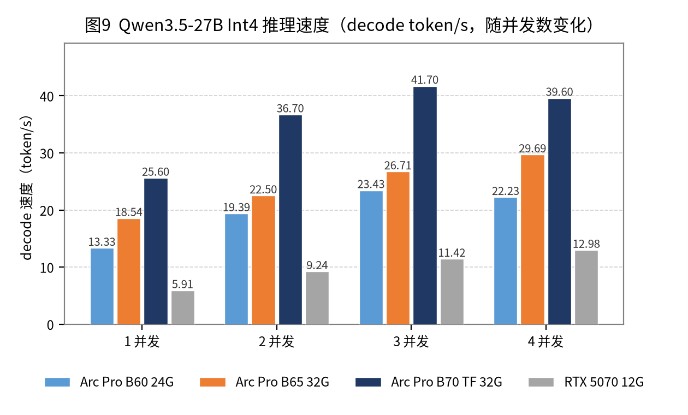

# B65（32 GB）本地 AI 落地方案 v2.1（历史设计）+ v3 当前实现摘要

> 适用环境：Windows 11 专业版宿主机（**不能装 Linux**）+ WSL2；Intel Arc Pro B65 32 GB；DDR5 64 GB（WSL2 限额 40 GB）。
> 本文只做**选型、评估与实施清单**，不执行任何安装。
> v2 更新（2026-10-21）：纳入 **Strata / XeStrata** 专家分层推理引擎，修正 v1 中「Flash-Next 不可行」的结论。
> v2.1 更新（2026-10-21）：按 **i9-13900 + 4×16 GB DDR5-4000** 修正内存带宽与速度预期；内存槽已满，IQ3_S 降为「可选/边缘」。
> 标注约定：**实测**＝第三方在 B65/B70 上的公开数字；**社区**＝个人报告、未复现；**估算**＝按带宽/算力推算。

---


---

> ## v3 当前实现（2026-10-22）
>
> 本文 v2.1 是**选型/估算记录**；实际落地已经升级，以下数字以当前仓库为准：
>
> | 项目 | v3 实际 |
> |---|---|
> | 默认 LLM | **IQ3_XXS**（70.6 GB，`lowRam=mmap`） |
> | 可选 | IQ3_S（77.9 GB，内存很紧）、IQ2_XS（63.4 GB，快速回退） |
> | 上下文 | 默认 **32768**；原生最大 **262144**；32K 已用 31,068 token 验证 |
> | 速度（32K） | decode 30–55 tok/s，prefill 约 1,250–1,300 tok/s |
> | 端口 | **稳定 8095**（`noWarmup=true`），DSH baseURL 不再漂移 |
> | 控制面 | `b65.ps1` + WinForms 面板 `app\B65Panel.ps1` + Web dashboard |
> | 测试 | `scripts\Test-Llm.ps1`，输出 `output\llm-tests` |
> | WSL2 | 可选，不影响 Windows 引擎；关掉可多 6–8 GB |
>
> **当前架构见 [docs/09-architecture.md](docs/09-architecture.md)**；测试与调优见
> [docs/08-llm-testing-optimization.md](docs/08-llm-testing-optimization.md)。
> 下面的 v2.1 内容保留为历史评估，IQ2_XS/48 GB/45–60 tok/s 等旧数字不再代表现状。
>
> ---


## 0. 一页结论（v2 历史，已被 v3 取代）

| 目标 | 推荐 | 一句话理由 | 预期表现（B65） |
|---|---|---|---|
| **LLM 能力上限** | **XeStrata + Qwen3.8-Flash-Next，IQ2_XS** | 125B-A6B 的专家放 RAM、CPU 与 GPU 并行算；32 GB 显存只放常驻件 + 热点专家缓存 | **45–60 tok/s**（DDR5-4000 折减，待实测） |
| LLM 质量优先 | 同上，换 **IQ3_S**（64 GB 属边缘） | 质量最好，但 62 GB 需求 + DDR5-4000 双重吃紧 | 30–45 tok/s，仅 setup 显示 ~55 GB 时可试 |
| LLM 稳定回退 | Qwen3.8-27B Q4_K_M（LM Studio） | 零折腾、零兼容风险；显存整仓装下 | 18–22 tok/s |
| **不推荐** | Flash-Next 的 Q4/Q5 量化 | Q4 要 108 GB，超过 32 GB 显存 + 64 GB 内存的合理水位 | 只能低比特，失去意义 |
| **视频首选（商用）** | ComfyUI XPU + Wan2.2 I2V-A14B | 唯一 Apache 2.0 的第一梯队视频模型；Intel 官方适配 | Turbo 约 6 分钟/5 秒@1536×1024 |
| 视频质量/音频升级 | MiniMax H3（33B） | 原生立体声 + 15 秒 + 768p | 预计 10 分钟级/5 秒，**商用许可需授权** |
| 写实备选 | HunyuanVideo 1.5（8.3B） | 720p 稳、自带 1080p 超分 | 3–6 分钟/5 秒（估算） |

**v2 的核心变化**：v1 说「64 GB 内存救不了 100B+ 模型」——那是针对 **llama.cpp / LM Studio / vLLM** 这类「权重必须映射进显存」的引擎。**Strata 是另一类引擎**：专家常驻 RAM，由 CPU 就地计算，不经过 Windows 的共享显存路径。所以 125B-A6B 在 32 GB 显存 + 64 GB 内存上**确实能跑**，这是 v1 需要修正的地方。

但有两个新约束必须说清楚：

1. **RAM 才是瓶颈，不是显存**。IQ3_S 要 ~62 GB RAM，64 GB Windows 只剩 2 GB 给系统——**装得下但跑不稳**；IQ2_XS（~48 GB）才是 64 GB 机器的安全档。
2. **32 GB 显存的专家命中率约 47%，不是 90%**。官方在 B70 上跑 IQ3_S 时，24,576 个专家里只有 **11.5k 驻留显存**（其余由 CPU 算）。命中率高估会导致对速度的预期偏高。

---

## 1. 前提校正

### 1.1 Windows 没有「统一内存」，但 Strata 不靠它

- B65 的 32 GB GDDR6 是**专用显存**，608 GB/s；
- Windows 的「共享 GPU 内存」上限通常是内存一半（64 GB → 32 GB），走 PCIe，只有几十 GB/s；
- 对 **llama.cpp / LM Studio / vLLM**：权重一旦溢出，就走这条慢路径，速度掉到个位数 tok/s。**所以这些引擎必须整仓进 32 GB。**
- 对 **Strata / XeStrata**：专家权重留在 RAM，CPU 用 AVX2/AVX-512 就地算，**不把专家映射成 GPU 共享内存**。因此 64 GB RAM 能被真正用起来，Windows 的 50% 共享显存上限不构成硬墙。

> 一句话：**「统一内存」是伪命题，但「CPU 和 GPU 分工算同一个 MoE」是真方案。**

### 1.2 WSL2 的 40 GB 只影响容器侧

- LM Studio / XeStrata / ComfyUI 跑 Windows 原生时，用完整 64 GB；
- vLLM、Intel llm-scaler 这类 Docker 方案才受 40 GB 限制；
- 两者共享同一块 B65，显存预算都是 32 GB，**WSL2 不会多给显存**；
- XeStrata 的 Linux 包明确「WSL 2 may work（PR welcome）」，且 setup 在 WSL2 里读不到 `/sys/class/drm`，**不要走 WSL2**。

### 1.3 B65 是「B70 减算力」，不是「B60 加显存」

| 规格 | B60 | **B65** | B70 |
|---|---|---|---|
| 架构 | BMG-G21 | **BMG-G31** | BMG-G31 |
| Xe 核心 / XMX | 20 / 160 | **20 / 160** | 32 / 256 |
| INT8 峰值 | 197 TOPS | **197 TOPS** | 367 TOPS |
| FP16 | ~99 TFLOPS | **~99 TFLOPS** | ~183 TFLOPS |
| 显存 / 位宽 | 24 GB / 192-bit | **32 GB / 256-bit** | 32 GB / 256-bit |
| 带宽 | 456 GB/s | **608 GB/s** | 608 GB/s |
| PCIe | 5.0 x8 | **5.0 x16** | 5.0 x16 |
| TBP | — | **200 W**（实测 180–190 W） | — |
| 国内参考价 | — | **8 999 元** | — |

**对 Strata 的含义**：

- 专家缓存容量与带宽和 B70 **完全一致** → 命中率一致，decode 不会被容量拖累；
- 但 GPU 还要算 attention、共享专家、以及命中的那 47% 专家，B65 只有 62.5% 的算力 → **decode 可能比 B70 低 10–20%，不是完全相等**；
- prefill 纯吃算力 → **约为 B70 的 60–65%**；
- **B65 与 B70 同为 BMG-G31**，所以 XeStrata 的 AOT 目标应选 `bmg-g31`（不是 B60/B580 的 `bmg-g21`）。这是能不能跑起来的第一道关。

### 1.4 三类引擎的容量规则完全不同

| 引擎 | 权重放哪 | 超出 32 GB 会怎样 | 这台机器能跑多大 |
|---|---|---|---|
| llama.cpp / LM Studio | 全部映射进 VRAM（可部分 offload 到共享内存） | 走 PCIe，慢 10–20 倍 | 27B–32B 稠密（Q4–Q8） |
| vLLM / llm-scaler | 全部进 VRAM，多卡 TP | OOM 或需要多卡 | 27B（单卡）；125B 需 4 卡 |
| **Strata / XeStrata** | 常驻件进 VRAM；**专家进 RAM，CPU 算** | RAM 不够才降级（low-RAM/SSD） | **125B-A6B（IQ2–IQ3）** |

---

## 2. LLM：Strata / XeStrata 路线

### 2.1 逐条核对材料里的关键说法

| 说法 | 核查结果 | 依据 |
|---|---|---|
| 技术叫 **Strata**，作者 Niko1221，MIT | ✅ 正确 | 上游仓库 MIT；XeStrata 为 LGPL-3.0-or-later AND MIT |
| **三级分层**：VRAM / RAM / SSD；SSD 只放 n-gram 表 | ✅ 正确 | 官方文档：SSD 放 **28.8 GB** n-gram 表，每 token 只读几行 |
| 每 GB 显存约 **700 个专家** | ✅ 正确 | 官方 How it works：「every extra GB holds ~700 more experts」 |
| 32 GB 显存命中率 **90%+** | ❌ **高估** | 官方 B70 + IQ3_S：**11.5k / 24.6k ≈ 47%**；其余显存被 attention、GDN、router、共享专家、输出头、MTP、KV 占用 |
| 从第 4–8 层评估路由、**提前 16 层**预取 | ⚠️ 未证实 | 公开文档只写「下一层的专家在上一层 attention 运行时通过 PCIe 预取」；16 层这数字未见 |
| 传统 offload 5.2 tok/s，Strata 45+ | ⚠️ 无法直接复核 | 官方 B70 IQ3_S 是 **30–41 tok/s**；XeStrata 比上游 SYCL 快 decode 15–95%、prefill 1.6–2.5× |
| 官方 Strata 的 Intel Arc 只支持 Linux | ✅ 正确 | 发布 zip 里**没有 Intel 引擎**；Windows 构建也没有；setup 在 Windows 会停下并指向 Linux 文档 |
| XeStrata Windows 包可用 | ✅ 正确 | `XeStrata-0.1.45-1-windows-x64.7z`；需 .NET 10 + VC++ |
| **必须 ≥ xe0.1.42** | ⚠️ 版本纪律对，具体警告未证实 | 当前 xe0.1.45-1；真正要确认的是 **AOT 目标 = bmg-g31**，别拿 bmg-g21 的包 |
| WSL2 不建议 | ✅ 正确 | 官方仅「may work」；B580 WSL2 有 device loss 报告 |
| PCIe 必须 x16、ReBAR 必须开 | ✅ 正确 | 专家缺失时走 PCIe；x4 会让所有 miss 转 CPU；ReBAR 影响 32 GB 寻址 |

### 2.2 Strata 到底怎么跑 125B

模型是 **24,576 个专家**，每个 token 只激活 10 个；总量 125B，激活 6B，另有 51B 的 n-gram 嵌入表。

| 层级 | 放什么 | 作用 |
|---|---|---|
| **GPU VRAM（32 GB）** | attention / GDN / QSA、router、共享专家、输出头、MTP 草稿层、KV cache，**剩下全做专家缓存** | 命中的专家在卡上算；每 GB ≈ 700 个专家 |
| **系统 RAM（64 GB）** | 全部 24,576 个专家（常驻、尽量锁页） | CPU 用 AVX2/AVX-512 **就地算未命中的**，与 GPU 并行 |
| **NVMe SSD** | 28.8 GB n-gram 查找表 | 每 token 只读几行，不占 RAM，也不放专家权重 |

另外两个提速点：

- **MTP 草稿**：模型自带草稿层，一次猜 3 个 token，主模型一次校验，平均 **2.4–3.2 token/次前向**，官方称 1.6–1.8×；
- **层间预取**：下一层要用的专家，在当前层 attention 计算时通过 PCIe 先搬。

**关键推论**：这套设计的瓶颈是 **RAM 容量 + 内存带宽 + CPU 算力**，不是显存带宽。所以：

- B65 与 B70 的 608 GB/s、32 GB 容量相同 → 专家缓存命中率相同；
- B65 的 20 个 Xe 核要算「命中专家 + attention」，比 B70 慢；
- **你的平台是 i9-13900 + 4×16 GB DDR5-4000**：理论 64 GB/s，按 70% 效率约 **45 GB/s**，比官方开发机（DDR4-3200，实测 35.5 GB/s）好约 25%，但比 DDR5-5600（~63 GB/s）低约 30%；
- **这不是小差距**：miss 专家要从 RAM 读，带宽直接决定 decode 上限（见 §2.5.1）。你之前看到的 55–65 tok/s，是按「DDR5-5600 级别内存」估的；4000 要往下修。

### 2.3 容量账：64 GB 内存到底能上哪一档

XeStrata 官方给出的模型档位（不同仓库的量化包不同，数字会有出入，以 setup 显示的为准）：

| 版本 | 下载 | 需要 RAM | 32 GB 显存可驻留 | 64 GB Windows 可行性 |
|---|---|---|---|---|
| Coder IQ1_M | 58 GB | 32 GB | 高 | ✅ 轻松，但只擅长代码 |
| **Q2_0** | 66 GB | 48 GB | 高 | ✅ 可行 |
| **IQ2_XS** | 68 GB | **48 GB** | 高 | ✅ **推荐起点** |
| IQ3_XXS | 76 GB | 60 GB | 中 | ⚠️ 很紧 |
| **IQ3_S** | 84 GB | **62 GB** | 中（11.5k/24.6k） | ⚠️ **64 GB 不够稳** |
| UD-IQ4_XS | 94 GB | 48 GB（全驻留需 ~80 GB） | 低 | ❌ 会走 SSD |
| UD-Q4_K_XL | 111 GB | 48 GB（全驻留需 ~80 GB） | 低 | ❌ 最慢 |

**结论**：

- **64 GB Windows 上，IQ2_XS 是唯一「舒适」的高质量档**；IQ3_S 需要把系统压到极致（关浏览器、加 pagefile），否则会 paging，速度反而更慢；
- **你的 4 个内存插槽已满**，换 2×32 GB 高速条成本高、收益约 15–20%，不建议为 IQ3_S 折腾——**直接把 IQ2_XS 定为长期档**；
- **IQ3_S 的唯一机会**：如果 setup 显示它只要 ~55 GB（Strata 自带的包，而非 XeStrata 的 62 GB 包），64 GB 可以试；但即便跑起来，DDR5-4000 也只有 30–45 tok/s；
- 如果想在现有硬件上突破 60 tok/s，**唯一路径是第二张 B65**（64 GB 显存，专家全部驻留，绕开 RAM 带宽）；但 Windows 多卡支持要先验证（见 §5）；
- 任何 Q4 档（UD-Q4_K_XL）在 32 GB 显存 + 64 GB 内存上都只能走 SSD/低 RAM，**不要考虑**。

### 2.4 公开实测锚点

| 平台 | 配置 | 模型 | Decode | 来源 |
|---|---|---|---|---|
| B70 32GB（内存未注明） | 官方 SYCL（上游 sycl/） | IQ3_S，11.5k 专家驻留 | **30（散文）–41（代码）tok/s**；4K prompt 980–1000 tok/s | 官方 INTEL.md，实测 |
| B70 32GB + 64GB | **XeStrata** | IQ3_S @256K、8-bit KV | **64.5–69.8 tok/s** | 社区报告，未复现 |
| 2× B70 32GB | XeStrata `--layer-split` | IQ3_XXS | 66 tok/s；prompt 394 tok/s | 社区，实测 |
| 2× B60 24GB | 官方 SYCL | IQ2_XS（全部专家在显存） | 58.6–61.3 tok/s；prompt 436 tok/s | 社区，实测 |
| 单 B60 24GB | 官方 SYCL | Coder IQ1_M（4,042/12,288 专家镜像） | 11.9 tok/s | 社区，实测 |
| B50 16GB | 官方 SYCL | IQ2_XS | 25–27 tok/s | 社区，实测 |
| B580 12GB + WSL2 | 官方 SYCL | IQ2_XS | ~21 tok/s，**且出现 device loss** | 社区，实测 |
| RTX 5070 12GB + 64GB | Strata 上游 | IQ3_S / IQ2_XS / Q2_0 | 53 / 79 / 94 tok/s | 官方 README，实测 |

读法：

- **B70 的 IQ3_S 落在 30–41（官方）到 64–70（XeStrata）之间**，差距来自 XeStrata 的内核优化和预取；
- **24 GB 单卡很惨（11.9）**，16 GB 只有 25–27 → **32 GB 是这条路线的最低舒适线**，你的卡正好在线上；
- 2×B60（48 GB 显存，全部专家在卡上）能到 58–61，说明「专家全驻留」比「CPU 算一半」更快——但单卡 32 GB 做不到全驻留。

### 2.5 B65 的预期（我的估算，不是实测）

| 档位 | Decode 预期 | Prefill 预期（4K） | 说明 |
|---|---|---|---|
| IQ2_XS | **45–60 tok/s** | 1,200–1,600 tok/s | 专家更小，驻留更多，miss 更少 |
| IQ3_S | **30–45 tok/s** | 900–1,300 tok/s | 质量最好；64 GB 容量边缘 + DDR5-4000 带宽不够 |
| Coder IQ1_M | 55–70 tok/s | 1,300–1,700 tok/s | 只建议代码场景 |

为什么比材料的 55–65 低：

- **内存带宽**：DDR5-4000 估计约 45 GB/s，比 5600 低 30%，而 miss 专家正是从 RAM 读；
- **GPU 算力**：B65 只有 B70 的 62.5%，还要算 47% 的命中专家 + attention，损失 10–20%；
- **Windows 锁页**：WDDM 最多锁约一半 RAM，更多 miss 落到 CPU；
- 首次 256K 上下文的 prefill 会非常慢（分钟级），不要拿它当交互体验。

### 2.5.1 DDR5-4000 到底影响多大

Strata 每生成一个 token，约 6B 激活参数；IQ2_XS 约 2.4 bit/权重，即 **~1.8 GB 活跃权重/token**。显存命中 50–60%，其余从 RAM 读：

| 内存 | 理论带宽 | 实测/估计 | 每 token RAM 流量（IQ2_XS，hit 55%） | RAM 侧参考上限 | 实际预期（含重叠） |
|---|---:|---:|---:|---:|---:|
| DDR5-5600 2×32 | 89.6 GB/s | ~63 GB/s | 0.81 GB | ~78 tok/s | 60–70 |
| **DDR5-4000 4×16（你的）** | **64.0 GB/s** | **~45 GB/s** | **0.81 GB** | **~55 tok/s** | **45–60** |
| DDR4-3200 2×16（官方开发机） | 51.2 GB/s | 35.5 GB/s | 0.81 GB | ~44 tok/s | 35–45 |

IQ3_S 约 3.33 bit/权重，活跃权重 ~2.5 GB/token，RAM 流量涨 40%，所以 **DDR5-4000 上只有 30–45 tok/s**；而且 62 GB 的 RAM 需求在 64 GB Windows 上本来就紧张——两个短板叠加，不建议。

> 说明：CPU 与 GPU 是并行的，部分 miss 会走 PCIe 由 GPU 算，所以实际值可以略高于「RAM 侧参考上限」；这张表用来判断趋势，不是硬上限。

**能改善吗？**

1. **BIOS 里看有没有 XMP/EXPO 档**：4 条 DDR5 在 13900 上通常被内存控制器压到 4000–4800；如果能稳定到 4800，带宽 +20%，decode 约 +10–15%。用 MemTest86 跑 30 分钟再定，工作机以稳定为先。
2. **换 2×32 GB DDR5-5600/6000**：带宽 +40%，但 4 槽换 2 槽要重新买条，成本高；你已排除。
3. **第二张 B65**：把专家全部放进 64 GB 显存，直接绕开 RAM 带宽，参考 2×B60 的 58–61 tok/s。这是唯一能明显超过 60 的路径，但要 9 000 元且 Windows 多卡待验证。
4. **接受 45–60**：对单人使用已经比 27B 的 18–22 快一倍以上，且模型能力强得多。

**验收线**：decode ≥ 40 tok/s（IQ2_XS）、≥ 30 tok/s（IQ3_S，若试）、RAM 峰值 < 60 GB、连续 3 轮 128K 不崩。

### 2.6 那还要不要 27B？

要，但角色变了：

| 场景 | 用谁 | 原因 |
|---|---|---|
| 难题、长文、Agent、代码库 | **Flash-Next（IQ2_XS）** | 原模型在 22 项基准里 21 项强于 27B；但 IQ2_XS 是 2-bit 档，代码/数学的优势会收窄，可用 27B 交叉验证 |
| 日常快问快答、开着视频渲染时 | **27B Q4** | 18–22 tok/s，显存整仓，RAM 占用小，不与 ComfyUI 抢内存 |
| 需要绝对稳定、不想折腾 | **27B Q4** | LM Studio 一条命令，零兼容风险 |
| 图片/视频理解 | 两者都行 | 都是原生多模态；Flash-Next 更强 |

**注意：Strata 和 ComfyUI 不能同时跑。** Strata 要锁 48–62 GB RAM，ComfyUI 视频要 20–30 GB 显存；同一台 64 GB 机器上，必须分时：

- 白天：Strata 常驻，写方案/改代码；
- 晚上/出片：停 Strata，跑 ComfyUI；
- 或者反过来：ComfyUI 出片时用 27B（RAM 占用小）。

### 2.7 XeStrata Windows 落地步骤（不执行，只列清单）

#### 0）先决条件

| 项 | 要求 | 检查 |
|---|---|---|
| GPU | B65，驱动 **32.0.101.8976** 或更新 | 设备管理器 |
| CPU | **i9-13900**（8P+16E，AVX2/AVX-VNNI，无 AVX-512） | 任务管理器/CPU-Z；Strata 自动走 AVX2 内核 |
| 内存 | **4×16 GB DDR5-4000（4 槽满）** | 理论 64 GB/s、按 70% 效率约 45 GB/s；**这是主要瓶颈** |
| BIOS | Above 4G Decoding + **Re-Size BAR** 开，CSM 关 | GPU-Z / BIOS |
| PCIe | **电气 x16**（不是 x8/x4），Gen4/Gen5 均可 | 主板手册 / HWiNFO |
| 显示 | 尽量用核显输出，B65 纯计算 | 任务管理器「专用 GPU 内存」 |
| 内存 | 64 GB 起；IQ3_S 建议 96 GB | 任务管理器 |
| 磁盘 | NVMe，模型 60–110 GB + 余量 | — |
| 运行时 | **.NET 10 Desktop Runtime** + **VC++ x64 Redistributable** | 安装时若缺会提示 |
| 页面文件 | 系统托管，建议 ≥ 64 GB（放 NVMe） | 系统属性 |

#### 1）下载与版本

- 文件：`XeStrata-0.1.45-1-windows-x64.7z`（GitHub Releases，附 `SHA256SUMS`）；
- **校验 SHA256**；
- 解压到独立目录（建议非系统盘、路径不含中文，避免权限与编码问题）；
- **版本纪律**：社区建议用 xe0.1.42 以上的包（具体缺陷范围未见官方公告，但版本越新越好）；解压后先跑 `xestrata-cli.exe --check`，确认：
  - 识别到 `Intel(R) Arc(TM) Pro B65`；
  - AOT/设备目标是 **`bmg-g31`**（B65 与 B70 同核心）；
  - 若显示 `bmg-g21` 或直接报「no engine for this GPU」，**停**，换包或提 issue，不要硬跑。

#### 2）首次配置

```
xestrata.exe            # 图形安装器：选 GPU → 选模型 → 选上下文 → 是否读图 → 下载
xestrata-cli.exe --check
```

建议的第一套参数：

| 参数 | 建议 | 理由 |
|---|---|---|
| 模型 | **IQ2_XS** | 64 GB 内存下唯一舒适档 |
| 上下文 | **32K 起步**，稳定后 64K/128K | 256K 的 KV 会挤占专家缓存，且首次 prefill 很慢 |
| KV | 8-bit（默认） | 省显存给专家缓存 |
| 图片 | 先关，稳定后再开 | Arc 上图片路径曾出现 GPU reset 报告 |
| 显存保留 | 默认 700 MiB；桌面占用高时加 `--vram-reserve-mib 1024` | 留出 WDDM 桌面开销 |

#### 3）启动与验证

```
xestrata-cli.exe --bench            # 约 40 分钟，产出 records/bench-*/summary.md
xestrata-cli.exe --calibrate        # 5–10 分钟，自动调 PCIe/CPU 分摊
```

看三个数：

1. **专家驻留行**：`N of 24,576 experts resident` —— 32 GB 下预期 11k 左右（约 45%），明显低于 8k 说明显存被桌面/上下文吃掉了；
2. **decode / prefill**：对照 §2.5 的验收线；
3. **RAM 峰值**：超过 60 GB 就会开始 paging，必须降档或加内存。

#### 4）Windows 专属调优（若该版本支持）

Strata 上游在 Windows 有两个开关，XeStrata 的 Windows 实现可能未同步，**先确认配置里能写再改**：

```json
"args": [ ..., "--adapt-async", "1" ],
"env": { "STRATA_PIN_BY_NEED": "1" }
```

- `STRATA_PIN_BY_NEED`：Windows 只能锁约一半 RAM，优先锁 GPU 最需要的专家，官方称 prompt 读取 +4.4%；
- `--adapt-async 1`：专家缓存换页放到辅助线程，官方称 decode +4–5%；
- 这两个都是「锦上添花」，跑不通不影响主流程。

#### 5）接进工作流

- Web UI：`http://127.0.0.1:8095`
- OpenAI 兼容：`http://127.0.0.1:8095/v1`（任意 key）
- Anthropic 兼容：`http://127.0.0.1:8095/v1/messages`
- 用 `xestrata-cli.exe --host 0.0.0.0 --api-key <secret>` 可给局域网/手机用。

### 2.8 27B 回退方案（保留 v1 的结论）

如果 XeStrata 在 B65 + Windows 上跑不起来（见 §6 风险），回退到：

| 量化 | 权重 | 128K 上下文 | Decode | 用途 |
|---|---|---|---|---|
| **Q4_K_M** | 17.4 GB | 21.4 GB | 18–22 tok/s | 日常主力 |
| Q6_K | 23.7 GB | 28.8 GB | 14–16 tok/s | 高质量 |
| Q8_0 | 28.5 GB | 34.1 GB ❌ | 11–13 tok/s | 只能 32K |



运行时：LM Studio 0.4.26（Vulkan）→ 简单；llama.cpp SYCL + MTP → 35–42 tok/s；vLLM（WSL2）→ 只建议服务化，且 B65 不在 Intel 认证列表。

### 2.9 许可：Strata 与模型

| 对象 | 许可 | 对你的含义 |
|---|---|---|
| Strata（上游） | MIT | 内部使用无限制 |
| **XeStrata** | **LGPL-3.0-or-later**（含 MIT 部分） | 内部用没问题；**若把它的二进制打包进对外产品**，需履行 LGPL（动态链接、提供源码/替换方式） |
| Qwen3.8-Flash-Next | **Qwen Community License 1.0** | 一般商用免费；但 **MaaS 业务、以 AI 编程/办公助手为主营的产品**需单独签约；月活 >1 亿或月营收 >2000 万美元的产品需在 UI 标注模型名 |

> 你是「主力工作机器」自用，不对外分发模型/引擎，许可风险很低；但如果公司要把这套东西做成产品，先让法务看 Qwen Community License 1.0 与 LGPL。

---

## 3. 文生视频（产品广告）——v2 不变

### 3.1 候选横比

| 模型 | 参数 | 32 GB 本地可行性 | B65 单条 5 秒 | 分辨率/时长 | 音频 | 许可 | 结论 |
|---|---|---|---|---|---|---|---|
| **Wan2.2 I2V-A14B** | 27B MoE / 14B 激活 | ✅ Q4/Q5 GGUF 约 10–12 GB | **约 6 分钟**（Turbo，1536×1024） | 720p / 5 s | ❌ | **Apache 2.0** | **商用首选** |
| MiniMax H3 | 33B 稠密 | ✅ 剪枝 INT8 21 GB | 预计 10 分钟级 | 768p / 4–15 s | ✅ | 社区许可 | 质量升级，商用需授权 |
| HunyuanVideo 1.5 | 8.3B | ✅ FP8 约 9 GB | 3–6 分钟（估算） | 720p + 1080p SR | ❌ | 腾讯社区许可 | 写实备选 |
| LTX-2.3 | 22B | ✅ FP8 约 22 GB | 2–3 分钟 | 4K / 50 fps | ✅ | $10M 营收上限 | 商用不建议 |
| Wan2.7 | 27B MoE | ❌ 截至 2026-10 未见可本地部署权重（ComfyUI 仅 API 节点） | — | 1080p / 15 s | ✅ | — | 只能云端 |

### 3.2 企业广告的许可红线

| 模型 | 商用限制 | 结论 |
|---|---|---|
| **Wan2.2** | 无（Apache 2.0） | ✅ 可直接商用 |
| MiniMax H3 | 自建权重排除欧盟/英/韩/美；年营收 >2000 万美元需书面授权 | ⚠️ 中大型公司基本都要先谈 |
| HunyuanVideo 1.5 | 排除欧盟/英/韩；MAU 上限 1 亿 | ⚠️ 全球投放逐地区评估 |
| LTX-2.3 | 营收 >1000 万美元需付费；禁止竞争产品 | ❌ 不适合公司广告 |

**结论：主模型必须是 Wan2.2。** H3 只在拿到授权或做内部提案片时用。

### 3.3 推荐管线

```
产品实拍/渲染图（去背 PNG）
  ├─(1) 场景合成：Qwen-Image-Edit / FLUX Kontext
  │      锁 Logo、文字、材质；12–18 GB 显存，20–60 秒/张
  ├─(2) 图生视频：Wan2.2 I2V-A14B（GGUF Q5 + Lightning 4/8 步）
  │      首帧=合成图；20–26 GB 显存，5 秒 1536×1024 约 6 分钟
  ├─(3) 放大/插帧：SeedVR2 或 RIFE
  │      720p → 1080p/25fps，1–3 分钟
  ├─(4) 声音：IndexTTS 2 / VoxCPM 1.5 + 音乐库
  └─(5) 剪辑：剪映专业版 / DaVinci
```

三条经验：**不要让模型「想象」产品**；**首帧决定 70% 质量**；**中文文字一律后期贴**。

### 3.4 产能

| 任务 | 单条 | 一小时 |
|---|---|---|
| Wan2.2 I2V 5s@1536×1024 Turbo | ~6 min | ~9–10 条 |
| Wan2.2 I2V 5s@720p 标准 20 步 | ~30–50 min | 1–2 条 |
| HunyuanVideo 1.5 5s@720p | 3–6 min | 10–15 条 |
| MiniMax H3 5s@768p | 10–15 min | 4–6 条 |

一条 30 秒广告 ≈ 6–8 镜头 × 2–3 条 ≈ **1.5–3 小时 GPU**；一天 2–4 条是合理预期。

### 3.5 与 Strata 的互斥

- Strata 常驻时，RAM 被锁 48–62 GB，ComfyUI 的视频模型加载会触发 paging；
- 同一块 B65 的 32 GB 显存也不能同时装下 Strata 的专家缓存和 Wan2.2 的 20–26 GB；
- **必须分时**：关掉 XeStrata 的窗口/进程 → 跑 ComfyUI → 再启 XeStrata。写个批处理即可。

---

## 4. 落地清单（按顺序，本文不代跑）

### 4.1 系统准备

| 项 | 要求 | 检查 |
|---|---|---|
| BIOS | Above 4G + ReBAR 开，CSM 关 | GPU-Z |
| 驱动 | Arc Pro 32.0.101.8976+ | 设备管理器 |
| PCIe | 电气 x16 | 主板手册 / HWiNFO |
| 显示 | 核显输出，B65 纯计算 | 专用显存占用 |
| 页面文件 | ≥ 64 GB，NVMe | 系统属性 |
| 磁盘 | 模型 200 GB + 视频 500 GB | — |
| 电源 | 高性能；B65 200 W + CPU 满载留足余量 | — |

### 4.2 LLM 步骤（两条路线，先 A 后 B）

**A. XeStrata + Flash-Next（能力上限）**

1. 装 .NET 10 Desktop Runtime + VC++ x64；
2. 解压 `XeStrata-0.1.45-1-windows-x64.7z`，校验 SHA256；
3. `xestrata-cli.exe --check` → 确认 B65、`bmg-g31`；
4. 选 **IQ2_XS**、32K、图片关；下载 ~68 GB；
5. 首次启动等 1–3 分钟（读 48 GB 进 RAM），别关窗口；
6. `--bench` + `--calibrate`，记录 decode/prefill/驻留/内存峰值；
7. 稳定后把上下文提到 64K–128K；256K 只在需要时开；
8. 接 OpenAI/Anthropic 兼容端点。

**B. 27B 回退（稳定日常）**

1. LM Studio 0.4.26，Runtime = Vulkan；
2. 下载 `Qwen3.8-27B-GGUF` Q4_K_M（16.5 GB）；
3. GPU Offload 拉满，ctx 64K，KV Q8；
4. 验收：decode ≥ 15 tok/s、128K 不 OOM。

### 4.3 视频步骤

1. ComfyUI Intel Portable 0.34.0（Python 3.13 + torch 2.13.0+xpu）；
2. 节点：`ComfyUI-GGUF-XPU`、`KJNodes`、`VideoHelperSuite`、`ComfyUI-OmniXPU`；
3. 模型：Wan2.2 I2V 14B GGUF Q5（high/low noise）、`umt5_xxl_fp8`、`wan_2.1_vae`、Lightning 4-step LoRA；
4. 启动：`--enable-dynamic-vram --reserve-vram 4`，`OMNIXPU_PROVIDER_BOOTSTRAP=required`、`OMNI_ATTN_BACKEND=cute`；
5. 先 512×512/49 帧验证链路，再上 1536×1024；
6. 验收：5 秒 ≤ 8 分钟、显存 < 31 GB、连续 5 条不 OOM。

### 4.4 验收记录表

| 指标 | 目标 | 实测 | 备注 |
|---|---|---|---|
| XeStrata 识别 GPU | B65 + bmg-g31 | | `--check` |
| Flash-Next IQ2_XS decode | ≥ 40 tok/s | | 32K；DDR5-4000 下 45–60 属正常 |
| Flash-Next IQ2_XS prefill | ≥ 1,200 tok/s | | 4K |
| 专家驻留 | ≥ 10k / 24,576 | | 启动日志 |
| RAM 峰值 | < 60 GB | | 任务管理器 |
| 256K 首 token | < 5 min | | 非交互 |
| 27B Q4 decode | ≥ 15 tok/s | | 回退线 |
| Wan2.2 5s@1536×1024 | ≤ 8 min | | Turbo |
| 连续 5 条视频 | 0 OOM | | 稳定性 |

---

## 5. 预算与升级路径

| 方案 | 成本 | 收益 | 建议 |
|---|---|---|---|
| 当前单卡 + 64 GB | 0 | IQ2_XS，50–70 tok/s | **先跑这一档** |
| 换 2×32 GB DDR5-5600 | 高（4 条全换） | 带宽 +40%，decode +15–20%；仍上不了 IQ3_S | 不建议，性价比低 |
| 第二张 B65 | ~9 000 元 | 64 GB 显存：IQ2_XS 专家全驻留，绕开 RAM 带宽；参考 2×B60 的 58–61 tok/s | 想稳定 60+ 才考虑；Windows 多卡待验证 |
| 换 B70 | 差价 | prefill/视频快 ~1.5×，显存不变 | 只做视频才值 |
| 云端 API | 按量 | hero shot、2K、音频 | 保留 10–20% 预算 |

**升级优先级（按你的约束修正）**：第二张 B65（绕开 RAM 带宽）> 换 2×32 高速内存（成本高、收益有限）> 换 B70。内存已 4 槽满，不加容量的话，IQ2_XS 就是这台机器的长期档。

---

## 6. 风险清单（Strata 路线特有）

1. **Windows + Intel 是 XeStrata 里验证最少的分支**：官方只在 RTX 3050 笔记本上验过 Windows；Intel 的 Windows 路径没有公开的大规模验证。能跑，但要接受折腾。
2. **B65 本身没有被官方测试**：开发/验收卡是 B70（同 G31 核心）。理论上兼容，实际可能卡在 PCI id 识别、AOT 目标或显存分配。**先跑 `--check` 再下载 68 GB**。
3. **AOT 目标必须是 bmg-g31**：B60/B580 是 bmg-g21，拿错包会「能启动但输出错/崩」。这是社区最常见的翻车点，比版本号更重要。
4. **64 GB 内存是硬约束**：IQ3_S 要 62 GB，Windows 只剩 2 GB；paging 会让速度断崖。**IQ2_XS 是安全档**。
5. **WDDM 锁页限制**：Windows 最多锁约一半 RAM 给 GPU，更多 miss 会走 CPU；比 Linux 慢 10–30%（估算，无公开对比）。
6. **首次启动会卡顿 1–3 分钟**：要读 48–62 GB 进 RAM；不要以为死机。
7. **单请求**：默认一次一个请求；多人用要 `--parallel`，会分摊速度。
8. **与 ComfyUI 互斥**：RAM/VRAM 都抢，必须分时。
9. **许可**：XeStrata LGPL；模型 Qwen Community License 1.0（MaaS/AI 编程产品需单独签约）。
10. **质量**：IQ2_XS 是 2-bit 档，代码/数学会比 IQ3_S 弱；如果主要写代码，优先 IQ3_S + 加内存。
11. **WSL2 别碰**：官方只写「may work」，B580 有 device loss 报告。
12. **DDR5-4000 + 4 槽满**：这是本机最容易被忽略的瓶颈。Strata 的 miss 专家从 RAM 读，带宽只有 5600 的 70%；decode 预期要按 45–60（IQ2_XS）而不是 55–65 来定。视频生成不受影响（模型加载后主要在显存里跑）。

---

## 7. 参考资料

**Strata / XeStrata**

- Strata 上游（MIT，架构说明）：<https://github.com/Niko1221/Strata>
- Strata「How it works」（28.8 GB n-gram 表、700 专家/GB、MTP）：<https://github.com/Niko1221/Strata/blob/main/docs/HOW_IT_WORKS.md>
- Strata Intel Arc 文档（仅 Linux、无 Windows 引擎、B70 11.5k 专家/30–41 tok/s）：<https://github.com/Niko1221/Strata/blob/main/docs/INTEL_ARC.md>
- XeStrata（Windows 7z、.NET 10/VC++、Intel/NVIDIA）：<https://github.com/MistVVK/XeStrata>
- XeStrata Intel 细节（bmg-g31、prefill 1.6–2.5×、decode +15–95%、PCIe 分摊）：<https://github.com/MistVVK/XeStrata/blob/main/docs/XE.md>
- XeStrata 细节（专家缓存、700 MiB 保留、模型档位）：<https://github.com/MistVVK/XeStrata/blob/main/docs/DETAILS.md>
- XeStrata Releases（`XeStrata-0.1.45-1-windows-x64.7z`）：<https://github.com/MistVVK/XeStrata/releases>

**Qwen3.8-Flash-Next**

- 官方模型卡：<https://huggingface.co/Qwen/Qwen3.8-Flash-Next>
- Qwen Community License 1.0 说明（商用边界、营收/MAU 条款）：<https://pc.watch.impress.co.jp/docs/news/2135941.html>
- 规格与基准（125B-A6B、SWE-bench Pro 62.5、JobBench 55.7）：同上
- 显存/量化表：<https://llmrun.dev/model/qwen-qwen3-8-flash-next>

**B65 / 实测**

- B65 官方规格：<https://www.intel.com/content/www/us/en/products/sku/245796/intel-arc-pro-b65-graphics/specifications.html>
- 蓝戟 B65 TF 32G 评测（LM Studio Vulkan、27B/20B、ComfyUI 6 分钟）：<https://www.koolcenter.com/t/topic/30687>
- B65 模型适配与速度库：<https://llmrun.dev/gpu/arc-pro-b65>
- B70 视频生成基准：<https://github.com/PMZFX/intel-arc-pro-b70-benchmarks/blob/master/video-generation.md>
- B60 双卡 96 GB 实测（PCIe 带宽、ComfyUI）：<https://www.vgover.com/zh-tw/news/201137>

**视频与许可**

- Intel llm-scaler（B60/B70、Wan2.2/H3/LTX 工作流）：<https://github.com/intel/llm-scaler>
- Intel ComfyUI Windows Portable：<https://github.com/intel/llm-scaler/blob/main/omni/docs/WINDOWS_PORTABLE.md>
- ComfyUI Wan2.2：<https://docs.comfy.org/tutorials/video/wan/wan2_2>
- ComfyUI HunyuanVideo 1.5：<https://docs.comfy.org/tutorials/video/hunyuan/hunyuan-video-1-5>
- MiniMax H3 显存分档：<https://minimaxh3.app/zh/posts/minimax-h3-vram-requirements>
- MiniMax H3 许可：<https://minimaxh3.app/zh/posts/is-minimax-h3-open-source>

> 说明：本文所有「社区」数字来自单点报告，未复现；B65 的 45–60 tok/s 是按 B70 数据 + 核心数 + DDR5-4000 带宽折减的估算，落地前必须用 §4.4 的表格自测。厂商/媒体的跑分与许可条款都可能变化，商用前以最新官方文本为准。
