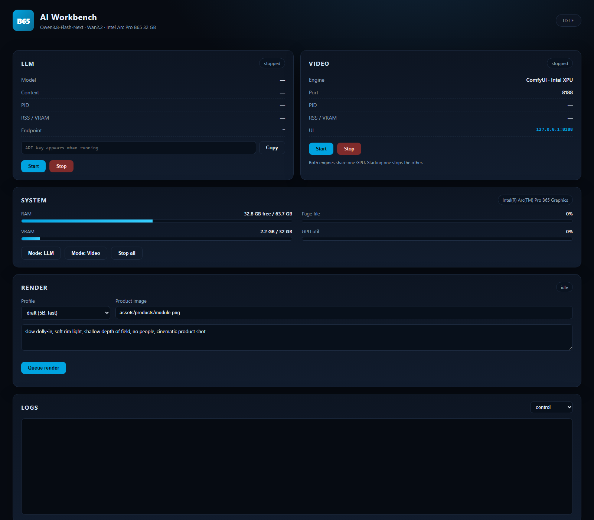

# B65 AI Workbench

Windows + VS Code control plane for one **Intel Arc Pro B65 32 GB**:

1. **LLM** — `Qwen3.8-Flash-Next IQ2_XS @ 32K` on **XeStrata** (Strata for Intel GPUs), with start/stop, RAM guard, LAN OpenAI-compatible API and token.
2. **Video** — ComfyUI Intel XPU + Wan2.2 (5B draft / 14B final + 1080p finishing), plus HTML spec cards and an FFmpeg assembler for **IoT module training / promotion videos without human footage**.

Both engines share one GPU, so the workbench enforces an **exclusive mode**: starting one stops the other.



> Design notes, measurements and licensing: [B65_本地AI落地方案.md](B65_本地AI落地方案.md) (Chinese).

---

## Quick start

Open the folder in VS Code, then run the tasks (`Terminal -> Run Task`) or use a PowerShell terminal:

```powershell
.\b65.ps1 setup                 # folders + portable 7-Zip + FFmpeg
.\b65.ps1 install llm           # XeStrata binaries (no model yet)
.\b65.ps1 install llm -RunSetup # one-time: IQ2_XS + 32K + ModelScope (~68 GB)
.\b65.ps1 install video         # ComfyUI Intel XPU portable pack

.\b65.ps1 llm start             # waits for :8095, prints LAN URL + API key
.\b65.ps1 status                # RAM / VRAM / processes
.\b65.ps1 dashboard             # http://127.0.0.1:8099

.\b65.ps1 models -Profile draft # Wan2.2 5B + text encoder + VAE (~18 GB)
.\b65.ps1 video start
.\b65.ps1 render -Profile draft -Image .\assets\products\module.png -Prompt "slow dolly-in, soft rim light, no people"

.\b65.ps1 card -Data .\config\cards\example.json
.\b65.ps1 build -Manifest .\projects\iot-demo\manifest.json
```

## Requirements

| Item | Requirement |
|---|---|
| OS | Windows 11 (Windows PowerShell 5.1 is enough) |
| GPU | Intel Arc Pro B65 32 GB, driver **32.0.101.8976** or newer |
| CPU | i9-13900 class (AVX2; AVX-512 not required) |
| RAM | 64 GB (IQ2_XS needs ~48 GB; IQ3_S is not practical here) |
| BIOS | Above 4G Decoding + Re-Size BAR on, CSM off |
| Runtime | .NET 10 Desktop Runtime, VC++ x64 Redistributable |
| Disk | ~120 GB for LLM + ~80 GB for video models |

No WSL2: XeStrata's Linux/Arc path does not work reliably under WSL, and ComfyUI should run natively for full VRAM.

The UHD 770 is deliberately left as a **display/QSV-only** device; see [docs/07-igpu.md](docs/07-igpu.md).

## How it works

```
b65.ps1 ── scripts\B65.psm1 (state, metrics, process control)
   ├─ Llm.ps1 / Video.ps1 ── exclusive start-stop
   ├─ Watch-Resources.ps1 ── RAM/VRAM sampler + safety stop
   ├─ Start-Dashboard.ps1 ── local web console (:8099)
   ├─ Invoke-Render.ps1 ── ComfyUI /prompt + /history
   ├─ New-SpecCard.ps1 ── HTML → Edge headless PNG
   └─ Build-Video.ps1 ── FFmpeg normalize / concat / audio
```

State and logs live in `runtime\` (gitignored): `state.json`, `health.json`, `logs\*.log`, `logs\metrics.jsonl`.

## Commands

| Command | Purpose |
|---|---|
| `setup` | create folders, download 7-Zip + FFmpeg |
| `install llm\|video\|all` | unpack XeStrata / ComfyUI XPU |
| `models -Profile draft\|final` | download model weights (`-Endpoint` to override the mirror) |
| `llm start\|stop\|restart\|status` | LLM lifecycle |
| `video start\|stop\|restart\|status` | ComfyUI lifecycle |
| `mode llm\|video\|idle` | exclusive switch (stops the other engine) |
| `status [-Json]` | RAM/VRAM/process snapshot |
| `watch -Target llm\|video` | resource watchdog in the foreground |
| `dashboard` | web console on `127.0.0.1:8099` |
| `render -Profile ... -Image ... -Prompt ...` | submit a Wan2.2 workflow |
| `card -Data ...` | render a 1920×1080 spec card |
| `build -Manifest ...` | assemble the final video |
| `test-workflow -Profile ...` | validate node classes/inputs against ComfyUI |
| `test-qsv` | benchmark CPU vs B65 vs iGPU (UHD 770) H.264 encode |
| `gputemp` | B65 temperature / power / VRAM via Intel xpu-smi (UAC) |
| `doctor` | environment checks |

## RAM / VRAM budget

| Mode | VRAM | RAM | Guard |
|---|---|---|---|
| LLM (IQ2_XS, 32K) | ~28 GB | ~48 GB | warn < 8 GB free, stop < 4 GB free × 6 samples |
| Video (Wan2.2 final) | ~26 GB | ~20 GB | watchdog records VRAM; OOM handled by ComfyUI |
| Idle | ~2 GB (desktop) | — | — |

Thresholds are in `config\settings.json` (`watchdog`). The watchdog starts with the engine and writes `runtime\health.json`.

## Directory layout

```
apps\            XeStrata, ComfyUI (downloaded, gitignored)
models\          LLM + ComfyUI weights (gitignored)
tools\           7-Zip, FFmpeg (gitignored)
config\          settings, profiles, model manifest, card data
workflows\       ComfyUI API-format workflows
dashboard\       local web console
scripts\         PowerShell control plane
projects\        per-video manifests and cards
assets\          brand, product stills, card template
output\          renders (gitignored)
docs\            installation / operations / troubleshooting
runtime\         state, logs, metrics (gitignored)
```

## Licensing

- **Strata** is MIT; **XeStrata** is LGPL-3.0-or-later (fine for internal use; review if you ship the binaries).
- **Qwen3.8-Flash-Next** is under the Qwen Community License 1.0 (separate terms for MaaS / AI-coding products).
- **Wan2.2** is Apache 2.0 — the only model here that is unconditionally safe for commercial advertising.
- **MiniMax H3 / HunyuanVideo / LTX-2** have revenue, territory or MAU restrictions; see the report before using them commercially.

## Safety

- Never start the LLM and video engine together; use `mode` or the dashboard.
- Keep the page file on NVMe and at least 24 GB.
- If the desktop becomes sluggish, run `.\b65.ps1 llm stop`; the watchdog will do it automatically when free RAM stays below 4 GB.
