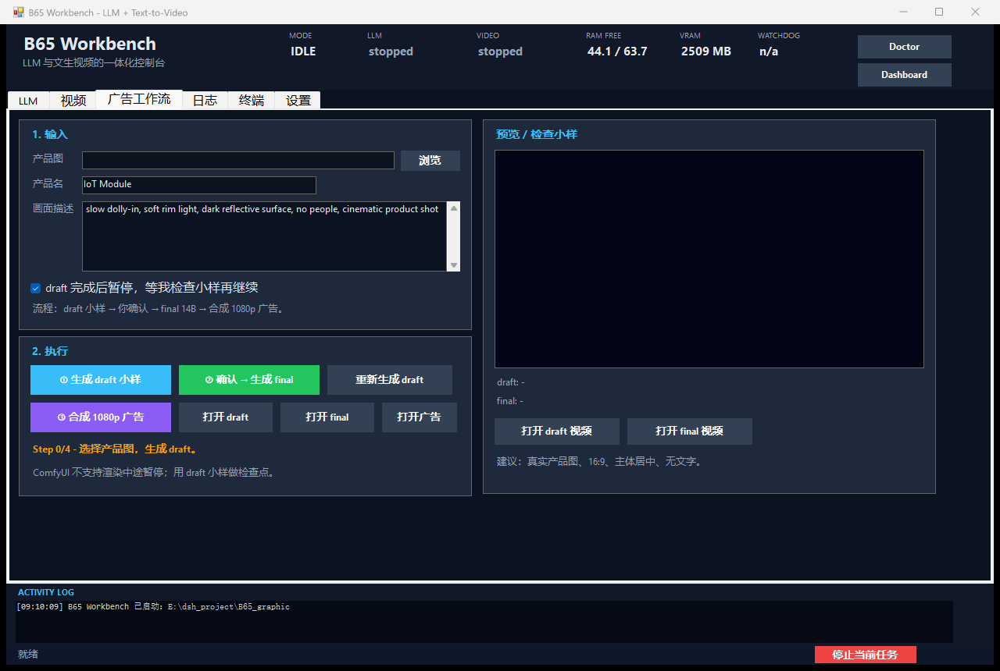

# 00 · Windows 控制台（B65 Workbench）



PowerShell 5.1 + WinForms 写的原生 Windows 面板，不需要 Electron、Node 或额外运行时。

## 启动

```powershell
cd E:\dsh_project\B65_graphic
.\b65.ps1 panel
```

也可以：

- 双击根目录的 **`B65 Panel.cmd`**；
- VS Code → Run Task → **B65: Control panel**；
- 直接打开指定页：` .\b65.ps1 panel -Tab workflow`（`llm` / `video` / `workflow` / `logs` / `terminal` / `settings`）。

## 页面

| 页面 | 功能 |
|---|---|
| **LLM** | 加载/启动、卸载/停止、重启、打开 API、复制 LAN Base URL / Key；显示模型、上下文、PID、RSS、显存；服务卡片里的 **“改为”** 下拉可选 **8K/32K/64K/128K/256K** 上下文，点 **应用上下文** 重启生效；模型档位卡在下方选择 IQ3_XXS / IQ3_S / IQ2_XS。DSH 的 contextWindow 需同步 |
| **视频** | 启动/停止 ComfyUI、打开 ComfyUI、快速渲染 draft/final、取消当前、最近输出列表（双击打开） |
| **广告工作流** | 产品图 + 描述 → draft 小样 → **暂停等你检查** → final 14B → 合成 1080p 广告 |
| **日志** | 选择 `runtime\logs\*.log`，自动刷新，打开日志目录 |
| **终端** | 内嵌 PowerShell，工作目录默认项目根，支持 `cd`、上下键历史 |
| **设置** | 打开 `llm.json` / `video.json` / `settings.json` / `models.json`，打开项目目录 |

底部 **ACTIVITY LOG** 始终显示当前动作和子进程输出；**停止当前任务** 可以结束正在跑的
`b65.ps1` 子进程树。

## 工作流如何“暂停”

ComfyUI 本身不支持渲染中途暂停/继续。面板用 **draft 小样** 做检查点：

1. 点“① 生成 draft 小样”（5B，832×480，约 1–2 分钟）；
2. 完成后自动显示首帧预览，流程停住；
3. 你看预览，满意就点“② 确认 → 生成 final”；不满意就改描述或点“重新生成 draft”；
4. final 完成后点“③ 合成 1080p 广告”，生成 `output\panel-ad.mp4`。

`draft 完成后暂停` 默认勾选；取消勾选也不会自动跑 final，仍由按钮控制。

## 设计原则

- 所有按钮最终调用 `b65.ps1`，面板只是快捷方式；同样的动作可以在终端复现。
- 32 GB 显存一次只跑一项：启动 LLM 会先停 ComfyUI，反之亦然。
- 动作在隐藏的 `powershell.exe` 子进程中执行，UI 不卡；输出写到 `runtime\logs\panel-*.log`。
- 终端里的命令也在独立进程中执行，`cd` 由面板自己跟踪。

## 常见问题

- **窗口在 4K/200% 下很大**：这是按主屏工作区自适应的 1280×860；如果觉得太大，把 Windows 缩放调到 150% 或把窗口拖小（内容区可滚动）。
- **按钮没反应**：先看底部 ACTIVITY LOG 是否出现“启动：…”，再看 `runtime\logs\panel-*.err.log`。
- **要停止卡住的任务**：点底部红色“停止当前任务”，它会 `taskkill /T` 整个子进程树。
